# Informe de proceso: Proyecto final, detección de similitud entre documentos

Dado un conjunto de documentos, se quiere saber cuáles se parecen entre sí. Cada documento
se resume por su **huella**: el conjunto de sus fragmentos de `k` palabras consecutivas. Dos
documentos se comparan con el **índice de Jaccard** de sus huellas, y un **índice invertido**
evita comparar las parejas que no comparten ningún fragmento. 

Este informe muestra cómo se ejecuta cada función: qué llamadas hace, qué queda en la pila 
y cómo se llega al resultado. Cada función tiene su sección, con la misma estructura. 

## Tipos de datos

```Scala
type Fragmento = Vector[String]
type Documento = (String, Vector[String])
type Corpus = Vector[Documento]
type Huella = Set[Fragmento]
type Indice = Map[Fragmento, Set[Int]]
type Pareja = (Int, Int)
type Medicion = (Int, Int, Double)
```

## Corpus de ejemplo 

Todas las trazas usan el ejemplo 1 del enunciado, con `k = 3`.

| Documento | Texto                           | Palabras | 
|-----------|---------------------------------|----------|
| `d0`      | `el gato duerme en el sofa`     | 6        |
| `d1`      | `el gato duerme en la alfombra` | 6        |
| `d2`      | `la lluvia moja el parque`      | 5        |

Sus huellas con `k = 3` son: 

| Documento | Fragmentos de la huella                                                         | Tamaño |
|-----------|---------------------------------------------------------------------------------|--------|
| `d0`      | `(el, gato, duerme)`, `(gato, duerme, en)`, `(duerme, en, el)`, `(en, el, sofa)` | 4      |
| `d1`      | `(el, gato, duerme)`, `(gato, duerme, en)`, `(duerme, en, la)`, `(en, la, alfombra)` | 4  |
| `d2`      | `(la, lluvia, moja)`, `(lluvia, moja, el)`, `(moja, el, parque)`                | 3      |

# `normalizar`

## Definición del algoritmo 

```Scala
def normalizar(texto: String): Vector[String] = {
    @tailrec
    def recorrer(cs: List[Char], actual: String, acc: Vector[String]) : Vector[String] = cs match {
      case Nil => if (actual.isEmpty) acc else acc :+ actual
      case c :: resto =>
        if (c.isLetterOrDigit) recorrer(resto, actual + c, acc)
        else if (actual.isEmpty) recorrer(resto, "", acc)
        else recorrer(resto, "", acc :+ actual)
    }
    recorrer(texto.toLowerCase.toList, "", Vector())
  }
```

* `normalizar` recibe un texto y devuelve el vector de sus palabras en minúsculas, sin signos
  de puntuación y sin cadenas vacías.

* El trabajo lo hace la función interna `recorrer`, que revisa el texto carácter por carácter.
  Recibe tres parámetros:
    * `cs`: los caracteres que faltan por revisar. 
    * `actual`: la palabra que se está armando.
    * `acc`: el acumulador con las palabras ya terminadas.
* `@tailrec` comprueba que `recorrer` sea recursión de cola.

## Explicación paso a paso

### Caso base

```Scala
case Nil => if (actual.isEmpty) acc else acc :+ actual
```

Cuando no quedan caracteres, se devuelve el acumulador. Si había una palabra a medio armar 
se agrega primero: así no se pierde la última palabra de un texto que termina en letra. 

### Caso recursivo 

```Scala
case c :: resto =>
```

Se toma el primer carácter `c` y hay tres posibilidades:

* **`c` es letra o dígito:** se pega a `actual` y se sigue con el resto. 
* **`c` es separador y `actual` está vacía:** no hay palabra que cerrar, se salta. Esto evita
  las cadenas vacías cuando hay dos separadores seguidos. 
* **`c` es separador y `actual` tiene letras:** la palabra terminó. Se agrega a `acc` y
  `actual` vuelve a quedar vacía. 

En los tres casos la llamada a `recorrer` es la última operación: no queda nada pendiente. 

## Llamados de pila en recursión de cola 

Ejemplo:

```Scala
normalizar("El, gato")
```

Primero `toLowerCase` deja `"el, gato"` y `toList` lo convierte en una lista de caracteres. 
En la tabla, `cs` se escribe como texto para abreviar. 

| Paso | `cs`         | `c`     | `actual` | `acc`          | Qué pasa                                  |
|------|--------------|---------|----------|----------------|-------------------------------------------|
| 1    | `"el, gato"` | `e`     | `""`     | `Vector()`     | letra: se pega a `actual`                 |
| 2    | `"l, gato"`  | `l`     | `"e"`    | `Vector()`     | letra: se pega a `actual`                 |
| 3    | `", gato"`   | `,`     | `"el"`   | `Vector()`     | separador: se cierra la palabra `"el"`    |
| 4    | `" gato"`    | espacio | `""`     | `Vector("el")` | separador con `actual` vacía: se salta    |
| 5    | `"gato"`     | `g`     | `""`     | `Vector("el")` | letra: se pega a `actual`                 |
| 6    | `"ato"`      | `a`     | `"g"`    | `Vector("el")` | letra: se pega a `actual`                 |
| 7    | `"to"`       | `t`     | `"ga"`   | `Vector("el")` | letra: se pega a `actual`                 |
| 8    | `"o"`        | `o`     | `"gat"`  | `Vector("el")` | letra: se pega a `actual`                 |
| 9    | `Nil`        | —       | `"gato"` | `Vector("el")` | caso base: se agrega `"gato"` y se devuelve |

Resultado: `Vector("el", "gato")`.

## Comportamiento de la pila

Son 9 llamadas a `recorrer`, pero nunca hay 9 marcos en la pila. Como la llamada recursiva es
lo último que se hace, el marco actual se **reemplaza** por el siguiente: lo único que cambia
son los valores de `cs`, `actual` y `acc`. La pila se mantiene de tamaño constante sin importar 
el largo del texto, y el resultado se devuelve una sola vez, desde el caso base. 

## Ejemplo de uso 

```Scala
println(normalizar("El, gato"))           // Vector(el, gato)
println(normalizar("¡Hola, Mundo 2026!")) // Vector(hola, mundo, 2026)
println(normalizar(" ,.;! "))             // Vector()
```

## Diagrama de llamados de pila con recursión de cola 

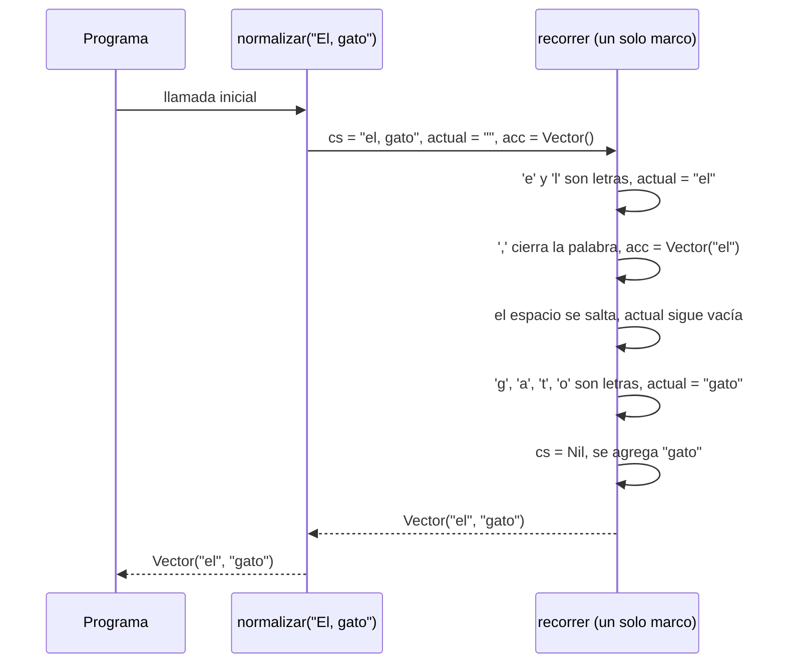

## Conclusión 

`normalizar` recorre el texto una sola vez con recursión de cola. El estado completo viaja en 
los parámetros `actual` y `acc`, por eso no quedan operaciones pendientes y la pila no crece. 

# `fragmentos`

## Definición del algoritmo

```Scala
def fragmentos(ts: Vector[String], k: Int): Vector[Fragmento] = {
    if (ts.length < k) Vector()
    else ts.take(k) +: fragmentos(ts.tail, k)
}
```

* `fragmentos` recibe las palabras `ts` de un documento y un entero `k`, y devuelve todos los 
  fragmentos de `k` palabras consecutivas, en el orden en que aparecen. 
* Con `t` palabras hay $t - k + 1$ fragmentos cuando $t \geq k$, y ninguno cuando $t < k$.
* Es recursión lineal: cada llamada toma un fragmento y se vuelve a llamar con el resto. 

## Explicación paso a paso 

### Caso base

```Scala
if (ts.length < k ) Vector()
```

Si quedan menos de `k` palabras ya no se puede formar ningún fragmento, y se devuelve el 
vector vacío sin hacer más llamados. 

### Caso recursivo

```Scala 
ts.take(k) +: fragmentos(ts.tail, k)
```

En cada llamada:

* `ts.take(k)` toma las primeras `k` palabras: ese es el fragmento que empieza en la posición actual. 
* `ts.tail` quita la primera palabra, de modo que la ventana se corre una posición.
* `+:` pone el fragmento al frente del resultado de la llamada recursiva. 
* Como falta hacer `+:` después de que la llamada recursiva responda, cada llamada deja una 
  operación pendiente en la pila. 

## Llamados de pila en recursión lineal 

Ejemplo, con las palabras de `d2`:

```scala
fragmentos(Vector("la", "lluvia", "moja", "el", "parque"), 3)
```

### Paso 1: Llamada inicial

```Scala
fragmentos(Vector(la, lluvia, moja, el, parque), 3)
// 5 >= 3 -> Vector(la, lluvia, moja) +: fragmentos(Vector(lluvia, moja, el, parque), 3)
```
### Paso 2: Primera iteración

```Scala
fragmentos(Vector(lluvia, moja, el, parque), 3)
// 4 >= 3 -> Vector(lluvia, moja, el) +: fragmentos(Vector(moja, el, parque), 3)
```

### Paso 3: Segunda iteración 

```Scala
fragmentos(Vector(moja, el, parque), 3)
// 3 >= 3 -> Vector(moja, el, parque) +: fragmentos(Vector(el, parque), 3)
```

### Paso 4: Caso base

```Scala
fragmentos(Vector(el, parque), 3)
// 2 < 3 -> Vector()
```

### Paso 5: Se desenvuelve lo pendiente 

```Scala
fragmentos(Vector(el, parque), 3)               // Vector()
fragmentos(Vector(moja, el, parque), 3)         // Vector((moja, el, parque))
fragmentos(Vector(lluvia, moja, el, parque), 3) // Vector((lluvia, moja, el), (moja, el, parque))
fragmentos(Vector(la, lluvia, moja, el, parque), 3)
// Vector((la, lluvia, moja), (lluvia, moja, el), (moja, el, parque))
```

En el punto más profundo hay 4 llamadas en la pila: 3 esperando su `+:` y el caso base.
Salen $5 - 3 + 1 = 3$ fragmentos, los mismos de la huella de `d2`.

## Diferencia con recursión de cola 

* En `fragmentos` cada llamada espera el resultado de la siguiente para ponerle su fragmento
  al frente. Por eso la pila crece con el documento: con `t` palabras se apilan $t - k + 2$ llamadas.
* En `normalizar` el resultado parcial viaja en el acumulador y la pila no crece. 

## Ejemplo de uso

```Scala
println(fragmentos(Vector("la", "lluvia", "moja", "el", "parque"), 3))
// Vector(Vector(la, lluvia, moja), Vector(lluvia, moja, el), Vector(moja, el, parque))
println(fragmentos(Vector("el", "parque"), 3)) // Vector()
```

## Diagrama de llamados de pila con recursión lineal

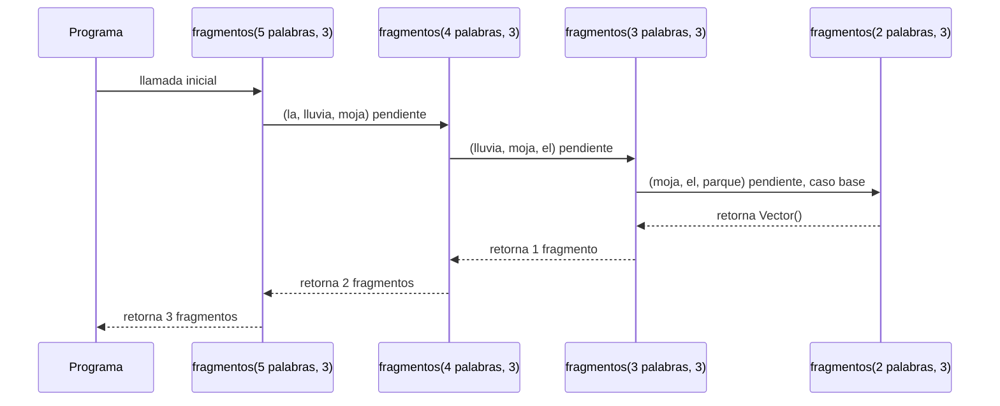

## Conclusión 

`fragmentos` desliza una ventana de `k` palabras con recursión lineal. Cada llamada deja un 
`+:` pendiente, así que la pila crece con el número de palabras y el resultado se arma de atrás hacia adelante. 

# `jaccard`

## Definición del algoritmo

```Scala
def jaccard(h1: Huella, h2: Huella): Double = {
    val comunes = (h1 intersect h2).size
    val total = h1.size + h2.size - comunes
    if (total == 0) 0.0 else comunes.toDouble / total
  }
```

* `jaccard` recibe dos huellas y devuelve qué tanto se parecen, con un número entre 0 y 1:


$$J(A, B) = \frac{|A \cap B|}{|A \cup B|}, \qquad J(\emptyset, \emptyset) = 0$$

* No es recursiva: son tres operaciones seguidas y no hay llamadas esperando en la pila. 

## Explicación paso a paso 

* **`comunes`:** `h1 intersect h2` deja los fragmentos que están en las dos huellas, y `.size`
  los cuenta. 
* **`total`:** es el tamaño de la unión. No hace falta construirla, porque 
  $|A \cup B| = |A| + |B| - |A \cap B|$: al sumar los dos tamaños los comunes se cuentan dos 
  veces, y por eso se restan una vez.
* **`total == 0`:** solo pasa cuando las dos huellas están vacías. Ahí se devuelve `0.0` y se
  evita dividir por cero. 
* **`toDouble`:** `comunes` y `total` son enteros. Sin la conversión, la división sería entera 
  y el resultado solo podría ser 0 o 1.

## Seguimiento de la ejecución

Se evalúa `jaccard` con las huellas del corpus de ejemplo. 

| Pareja     | `comunes` | `total`       | Resultado       |
|------------|-----------|---------------|-----------------|
| `d0`, `d1` | 2         | 4 + 4 - 2 = 6 | 2 / 6 = 0.333   |
| `d0`, `d2` | 0         | 4 + 3 - 0 = 7 | 0 / 7 = 0.0     |
| `d1`, `d2` | 0         | 4 + 3 - 0 = 7 | 0 / 7 = 0.0     |

`d0` y `d1` comparten `(el, gato, duerme)` y `(gato, duerme, en)`. `d2` no comparte ningún 
fragmento con los otros dos. 

## Ejemplo de uso

```Scala
val h0 = huella(d0, 3)
val h1 = huella(d1, 3)
println(jaccard(h0, h1))        // 0.3333333333333333
println(jaccard(h0, h0))        // 1.0
println(jaccard(Set(), Set()))  // 0.0
```

## Diagrama de flujo 

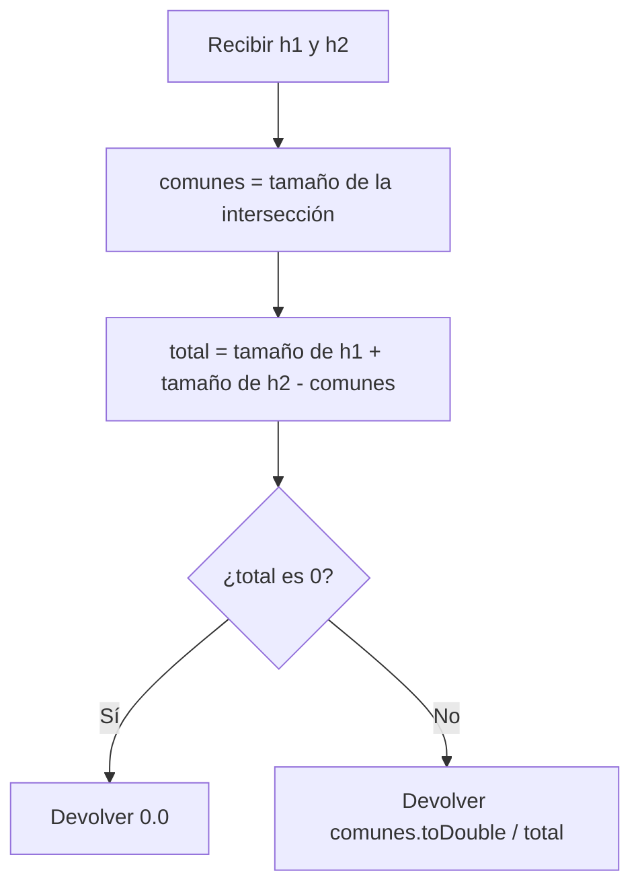

## Conclusión 

`jaccard` calcula la similitud con una intersección y una resta, sin construir la unión. El
caso de las dos huellas vacías se resuelve aparte para no dividir por cero. 

# `parejas`

## Definición del algoritmo

```Scala
def parejas(n: Int): Vector[Pareja] = 
  (for {
    i <- 0 until n
    j <- (i + 1) until n
  } yield (i, j)).toVector
```

* `parejas` recibe el número de documentos `n` y devuelve todas las parejas `(i, j)` con
  `i < j`, en orden. 
* Son $n(n-1)/2$ parejas: cada documento se empareja con los que están después de él.
* No es recursiva. Usa una expresión `for`, que el compilador convierte en llamadas a 
  funciones de alto orden. 

## Cómo traduce Scala una expresión `for`

Una expresión `for` con `yield` no es un ciclo: el compilador la reescribe como llamadas a 
`map`, `flatMap` y `withFilter`, que reciben una función como parámetro. 

| Forma del `for`                  | Se traduce a                       |
|----------------------------------|------------------------------------|
| `for (x <- e) yield f`           | `e.map(x => f)`                    |
| `for (x <- e if p) yield f`      | `e.withFilter(x => p).map(x => f)` |
| `for (x <- e1; y <- e2) yield f` | `e1.flatMap(x => e2.map(y => f))`  |

El **último** generador se traduce a `map` y todos los anteriores a `flatMap`.

## Traducción del `for`

```Scala
(0 until n).flatMap(i => ((i + 1) until n).map(j => (i, j))).toVector
```

* `i <- 0 until n` es el generador exterior, por eso es `flatMap`: para cada `i` produce una 
  colección de parejas y las concatena. 
* `j <- (i + 1) until n` es el último generador, por eso es `map`.
* `toVector` hace falta porque un `for` sobre un rango produce una `IndexedSeq`, y la firma
  pide un `Vector`.

## Seguimiento de la ejecución 

Se evalúa `parejas(3)`, porque el corpus de ejemplo tiene 3 documentos.

| `i` | Rango de `j`  | Parejas que aporta |
|-----|---------------|--------------------|
| 0   | `1 until 3`   | `(0, 1)`, `(0, 2)` |
| 1   | `2 until 3`   | `(1, 2)`           |
| 2   | `3 until 3`   | ninguna: rango vacío |


`flatMap` concatena lo que aportó cada `i`. Resultado: `Vector((0, 1), (0, 2), (1, 2))`, que 
son $3 \cdot 2 / 2 = 3$ parejas. 

Como `j` empieza en `i + 1`, nunca sale una pareja `(i, i)` ni una pareja repetida al revés.

## Ejemplo de uso

```Scala
println(parejas(3)) // Vector((0,1), (0,2), (1,2))
println(parejas(1)) // Vector()
println(parejas(0)) // Vector()
```

## Diagrama

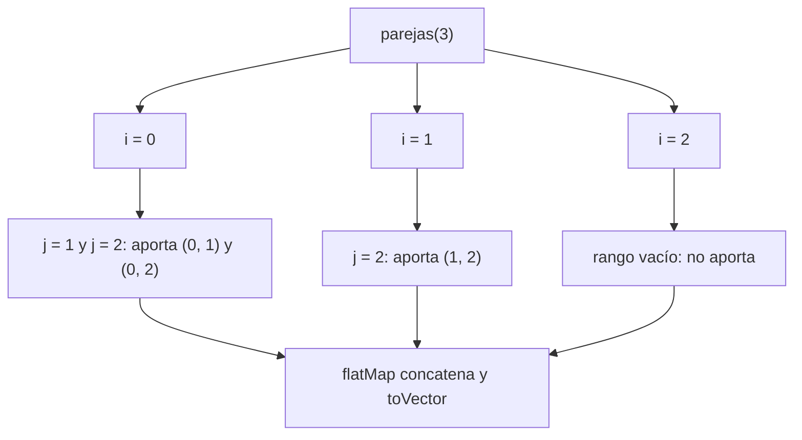

## Conclusión 

`parejas` es un `flatMap` con un `map` adentro. El rango `(i + 1) until n` garantiza que cada pareja
salga una sola vez y en orden. 

# `parejasCandidatas`

## Definición del algoritmo

```Scala
def parejasCandidatas(idx: Indice): Vector[Pareja] = {
    val cand = (for {
      ds <- idx.values.toList
      i <- ds
      j <- ds
      if i < j
    } yield (i, j)).toSet
    if (cand.isEmpty) Vector()
    else parejas(cand.map(par => par._2).max + 1).filter(par => cand.contains(par))
  }
```

* `parejasCandidatas` recibe el índice invertido y devuelve, sin repetir y en orden, las 
  parejas de documentos que comparten al menos un fragmento. 
* No es recursiva: combina una expresión `for` con las funciones de alto orden `map` y `filter`.

## Explicación paso a paso 

* **`idx.values.toList`:** toma los conjuntos de documentos del índice, uno por fragmento.
* **`i <- ds` y `j <- ds` con `if i < j`:** de cada conjunto saca todas las parejas de
  documentos, dejando solo las que tienen `i < j`.
* **`toSet`:** una pareja puede salir de varios fragmentos. Al pasar a conjunto queda una sola vez.
* **`cand.isEmpty`:** si ningún fragmento está en dos documentos no hay candidatas, y se
  devuelve el vector vacío. Además evita aplicar `max` a un conjunto vacío.
* **`cand.map(par => par._2).max + 1`:** como `i < j`, el mayor `j` es la posición más alta
  que aparece en alguna candidata. Sumarle 1 da cuántos documentos hay que considerar.
* **`parejas(...).filter(par => cand.contains(par))`:** `parejas` genera todas las parejas ya
  ordenadas, y `filter` deja solo las candidatas. Así el resultado sale ordenado sin escribir
  un ordenamiento.

## Traducción del `for`

```Scala
idx.values.toList.flatMap(ds =>
  ds.flatMap(i =>
    ds.withFilter(j => i < j).map(j => (i, j))))
```

Hay tres generadores: los dos primeros se vuelven `flatMap` y el último `map`. El `if` queda 
como `withFilter` pegado a `j`, y descarta sin construir una colección intermedia. 

## Seguimiento de la ejecución 

El índice invertido del corpus de ejemplo tiene 9 fragmentos:

| Fragmento                                       | Documentos | Parejas con `i < j` |
|-------------------------------------------------|------------|---------------------|
| `(el, gato, duerme)`                            | `Set(0, 1)` | `(0, 1)`           |
| `(gato, duerme, en)`                            | `Set(0, 1)` | `(0, 1)`           |
| `(duerme, en, el)`, `(en, el, sofa)`            | `Set(0)`    | ninguna            |
| `(duerme, en, la)`, `(en, la, alfombra)`        | `Set(1)`    | ninguna            |
| los tres fragmentos de `d2`                     | `Set(2)`    | ninguna            |

En un conjunto de un solo documento `i` y `j` son iguales, y `i < j` lo descarta. 


| Paso | Operación                               | Resultado                |
|------|-----------------------------------------|--------------------------|
| 1    | el `for` junta las parejas              | `List((0, 1), (0, 1))`   |
| 2    | `toSet` quita la repetida               | `Set((0, 1))`            |
| 3    | `cand.map(par => par._2).max + 1`       | `1 + 1 = 2`              |
| 4    | `parejas(2)`                            | `Vector((0, 1))`         |
| 5    | `filter(par => cand.contains(par))`     | `Vector((0, 1))`         |

Resultado: `Vector((0, 1))`. De las 3 parejas posibles solo hay que comparar una como dice el enunciado. 

## Ejemplo de uso

```Scala
val idx = indiceInvertido(huellas(c1, 3))
println(parejasCandidatas(idx))                    // Vector((0,1))
println(parejasCandidatas(Map(Vector("a") -> Set(2, 0, 1))))
// Vector((0,1), (0,2), (1,2))
println(parejasCandidatas(Map()))                  // Vector()
```

## Diagrama de flujo

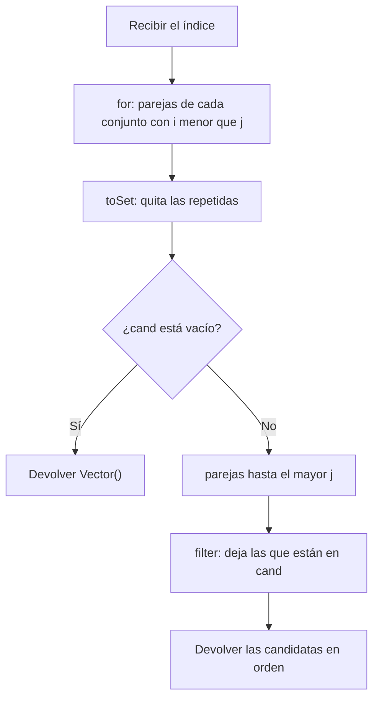

## Conclusión 

`parejasCandidatas` saca las parejas de cada entrada del índice con un `for` de tres
generadores, quita las repetidas con `toSet` y las ordena filtrando el resultado de `parejas`.

# `ranking`

## Definición del algoritmo

```Scala
def ranking(ss: Vector[Medicion], umbral: Double, p: Int): Vector[Medicion] = {
    // m1 va antes que m2: mayor similitud, y si empatan, menor posición (i, j).
    def vaAntes(m1: Medicion, m2: Medicion): Boolean = {
      m1._3 > m2._3 ||
        (m1._3 == m2._3 && (m1._1 < m2._1 || (m1._1 == m2._1 && m1._2 < m2._2)))
    }

    @tailrec
    def mezclar(xs: List[Medicion], ys: List[Medicion],
                acc: List[Medicion]): List[Medicion] = (xs, ys) match {
      case (Nil, _) => acc.reverse ++ ys
      case (_, Nil) => acc.reverse ++ xs
      case (x :: xs1, y :: ys1) =>
        if(vaAntes(x, y)) mezclar(xs1, ys, x :: acc)
        else mezclar(xs, ys1, y :: acc)
    }

    def msort(xs: List[Medicion]) : List[Medicion] = {
      val n = xs.length / 2
      if (n == 0) xs
      else {
        val (l1, l2) = xs.splitAt(n)
        mezclar(msort(l1), msort(l2), Nil)
      }
    }

    msort(ss.filter(m => m._3 >= umbral).toList).toVector.take(p)
  }
```

* `ranking` recibe las mediciones, un `umbral` y un tope `p`. Devuelve las que alcanzan el 
  umbral, de mayor a menor similitud y truncadas a `p`. 
* Tiene tres funciones internas:
    * `vaAntes`: decide cuál de dos mediciones va primero.
    * `mezclar`: junta dos listas ya ordenadas en una sola. Es recursión de cola. 
    * `msort`: ordena partiendo la lista en dos mitades. Hace dos llamadas recursivas. 

## Explicación paso a paso

### `vaAntes`

`m1` va antes que `m2` si tiene mayor similitud. Si empatan, va antes la de menor `i`, y si
también empatan en `i`, la de menor `j`. Así dos mediciones distintas nunca quedan indecisas y el resultado
no depende del orden en que llegaron. 

### `mezclar`

* **Casos base:** si una de las dos listas se acabó, se devuelve lo acumulado seguido de lo que queda de la otra.
`acc` se arma al revés, porque `x :: acc` agrega al frente; por eso se le aplica `reverse`.
* **Caso recursivo:** se comparan las cabezas `x` e `y` con `vaAntes`. La que va primero pasa al acumulador y se sigue con el resto. La 
llamada recursiva es lo último que se hace.

### `msort`

* **Caso base:** `n == 0` pasa cuando la lista tiene cero o un elemento. Ya está ordenada y se devuelve tal cual. 
* **Caso recursivo:** `splitAt(n)` parte la lista en dos mitades, cada una se ordena con su 
  propia llamada a `msort` y `mezclar` las junta. No es recursión de cola: después de las dos
  llamadas todavía falta mezclar. 

### La última línea

* `ss.filter(m => m._3 >= umbral)`: función de alto orden que deja las mediciones que 
  alcanzan el umbral. La comparación es `>=`, así que una medición igual al umbral entra. 
* `toList`: `mezclar` y `msort` trabajan con listas para usar los patrones `Nil` y `x :: xs`. 
* `toVector.take(p)`: vuelve al tipo de la firma y deja las primeras `p`.

## Seguimiento de las llamadas recursivas

En el corpus de ejemplo solo una pareja supera cero, y con una sola medición no hay nada que ordenar.
Por eso se usa este vector de cinco mediciones:

```Scala
val ss = Vector((0, 1, 0.4), (0, 2, 0.1), (1, 2, 0.9), (0, 3, 0.4), (1, 3, 0.7))
ranking(ss, 0.3, 3)
```

### Paso 1: Filtrar por el umbral

`(0, 2, 0.1)` no alcanza `0.3` y sale. Quedan cuatro, que se nombran para abreviar:

| Nombre | Medición      |
|--------|---------------|
| `A`    | `(0, 1, 0.4)` |
| `B`    | `(1, 2, 0.9)` |
| `C`    | `(0, 3, 0.4)` |
| `D`    | `(1, 3, 0.7)` |

### Paso 2: Bajan las llamadas de `msort`

```Scala
msort(List(A, B, C, D))   // n = 2 -> mezclar(msort(List(A, B)), msort(List(C, D)), Nil)
msort(List(A, B))         // n = 1 -> mezclar(msort(List(A)), msort(List(B)), Nil)
msort(List(A))            // n = 0 -> List(A), caso base
msort(List(B))            // n = 0 -> List(B), caso base
```

### Paso 3: Suben los resultados 

```Scala
mezclar(List(A), List(B), Nil)   // B tiene mayor similitud -> List(B, A)
msort(List(C, D))                // igual que la otra mitad -> List(D, C)
mezclar(List(B, A), List(D, C), Nil)
```

### Paso 4: La mezcla final

| Paso | `xs`         | `ys`         | `acc`           | Comparación                           |
|------|--------------|--------------|-----------------|---------------------------------------|
| 1    | `List(B, A)` | `List(D, C)` | `Nil`           | `B` (0.9) va antes que `D` (0.7)      |
| 2    | `List(A)`    | `List(D, C)` | `List(B)`       | `D` (0.7) va antes que `A` (0.4)      |
| 3    | `List(A)`    | `List(C)`    | `List(D, B)`    | empate en 0.4: `A` gana por `j` menor |
| 4    | `Nil`        | `List(C)`    | `List(A, D, B)` | caso base: `acc.reverse ++ ys`        |

Resultado de la mezcla: `List(B, D, A, C)`.

En el paso 3, `A = (0, 1, 0.4)` y `C = (0, 3, 0.4)` tienen la misma similitud y el mismo `i`.
Decide `j`: como `1 < 3`, `A` va primero.

### Paso 5: Truncar

`take(3)` deja las tres primeras:

```Scala
Vector((1, 2, 0.9), (1, 3, 0.7), (0, 1, 0.4))
```

## Comportamiento de la pila 

* **`msort`:** cada llamada parte la lista por la mitad, así que la profundidad de la pila 
  crece con el logaritmo del tamaño. Con 4 elementos hay 7 llamadas en total, pero como
  máximo 3 al mismo tiempo en la pila. 
* **`mezclar`:** es de cola. Su marco se reemplaza en cada paso y la pila no crece, sin 
  importar el largo de las listas. 

## Ejemplo de uso

```Scala
val ss = Vector((0, 1, 0.4), (0, 2, 0.1), (1, 2, 0.9), (0, 3, 0.4), (1, 3, 0.7))
println(ranking(ss, 0.3, 3))  // Vector((1,2,0.9), (1,3,0.7), (0,1,0.4))
println(ranking(ss, 0.95, 3)) // Vector()
println(ranking(ss, 0.0, 1))  // Vector((1,2,0.9))
```

## Diagrama de llamados de `msort`

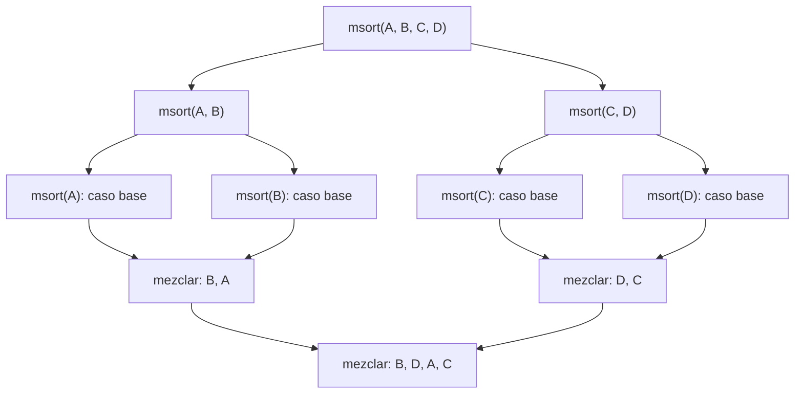

## Conclusión 

`ranking` filtra con una función de alto orden, ordena con un ordenamiento por mezcla y trunca a `p`. `msort` divide el problema con 
dos llamadas recursivas, `mezclar` junta las mitades con recursión de cola, y `vaAntes` fija un orden que no depende de cómo llegaron las mediciones. 


# Corpus adicionales

```Scala
val letras: Corpus = Vector(
  ("L0", normalizar("a b c")),
  ("L1", normalizar("b c d")),
  ("L2", normalizar("x y z")))


val corpus2: Corpus = Vector(
  ("e0", normalizar("la funcion recursiva termina cuando llega al caso base")),
  ("e1", normalizar("toda funcion recursiva termina cuando llega al caso base")),
  ("e2", normalizar("el paralelismo divide el trabajo en tareas independientes")),
  ("e3", normalizar("el paralelismo divide el trabajo en hilos independientes")))
```
Cada una de estas funciones tiene su propio ejemplo principal y uno adicional; `letras` y `corpus2` se reutilizan en varias secciones.

# `huella`

## Definición del algoritmo

```Scala
 def huella(d: Documento, k: Int): Huella =
    fragmentos(palabrasDoc(d), k).toSet
```

`huella` recibe un documento `d` y un tamaño de fragmento `k`, y devuelve el conjunto de los fragmentos de `k` palabras consecutivas de `d`. Si un fragmento aparece varias veces en el documento, el conjunto lo guarda una sola vez.

## Explicación paso a paso

1. **`palabrasDoc(d)`:** `d` es una pareja: el nombre del documento y su vector de palabras. Esta función extrae solo el vector de palabras; el nombre no participa en el cálculo.
2. **`fragmentos(..., k)`:** `k` es cuántas palabras tiene **cada fragmento**; no es cuántos fragmentos se generan. Se forma un fragmento por cada posición `i` donde caben `k` palabras, de la 0 a la `t - k` (con `t` el número de palabras), avanzando una palabra cada vez. El resultado es un `Vector[Fragmento]`: conserva el orden y puede tener fragmentos repetidos.

3. **`.toSet`:** convierte ese vector en un `Set[Fragmento]` (agrupa los elementos sin repetir): elimina las repeticiones y deja de tener orden. Por eso el resultado es una huella y no una lista.

Con `t` palabras salen `t - k + 1` fragmentos (ninguno si `t < k`); la huella tiene a lo sumo esa cantidad, porque los repetidos se unen.

## Seguimiento de la ejecución

**Ejemplo 1.** Documento `a b c d` con `k = 2`:

|Paso | Expresión | Valor |
|---|---|---|
| 1 | `palabrasDoc(d)` | `Vector(a, b, c, d)`|
| 2 | fragmento en la posición 0 | `Vector(a, b)` |
| 3 | fragmento en la posición 1 | `Vector(b, c)` |
| 4 | fragmento en la posición 2 | `Vector(c, d)` |
| 5 | posición 3 | no caben 2 palabras: termina |
| 6 | `.toSet` | `Set((a b), (b c), (c d))` |

**Ejemplo 2.** Documento `la luna brilla y la luna cae` con `k = 2`. Tiene 7 palabras, así que salen `7 - 2 + 1 = 6` fragmentos.

|Posición de inicio | Fragmento generado | ¿Ya estaba?|
|---|---|---|
| 0| `Vector(la, luna)`| no|
| 1| `Vector(luna, brilla)` | no|
| 2 | `Vector(brilla, y)` | no|
| 3 | `Vector(y, la)`| no|
| 4 | `Vector(la, luna)`| **sí**, es el de la posición 0 |
| 5 | `Vector(luna, cae)`| no |
| 6 | no caben 2 palabras | termina|

`fragmentos` entrega 6 elementos y `.toSet` junta el repetido: la huella tiene 5 fragmentos, `Set(Vector(la, luna), Vector(luna, brilla), Vector(brilla, y), Vector(y, la), Vector(luna, cae))`.

## Ejemplo con repeticiones

Documento con repetición, `d = ("R", Vector("sol","luna","sol", "luna"))` y `k = 2`:

| Posición de inicio | Fragmento generado |
|---|---|
| 0 | `Vector(sol, luna)`| 
| 1 | `Vector(luna, sol)`| 
| 2 | `Vector(sol, luna)`| 

`fragmentos` genera tres elementos, pero `huella` devuelve un conjunto de dos: `Set(Vector(sol, luna), Vector(luna, sol))`. Con un documento corto, `Vector("sol")` y `k = 2`, no cabe ningún fragmento y el resultado es `Set()`. Con un documento sin palabras el resultado también es `Set()`, y con `Vector("a", "b")` y `k = 2` hay un solo fragmento: `Set(Vector(a, b))`.

## Ejemplo de uso 1

```Scala
huella(("a", normalizar("a b a b a b")), 2)
  // Set(Vector(a, b), Vector(b, a))
```
## Ejemplo de uso 2

```Scala
huella(("R", normalizar("la luna brilla y la luna cae")), 2)
  //Set(Vector(la, luna), Vector(luna, brilla), Vector(brilla, y),
  //    Vector(y, la), Vector(luna, cae))
  
huella(("S", Vector("sol")), 2)
  // Set()
```

## Diagrama 

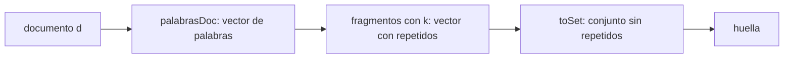

## Conclusión
  `huella` compone `palabrasDoc`, `fragmentos` y `toSet`: el resultado es el conjunto de los fragmentos de `k` palabras del documento, sin repetidos.

# `huellas`

## Definición del algoritmo


```Scala
  def huellas(c: Corpus, k: Int): Vector[Huella] =
    c.map(documento => huella(documento, k))

```  

`huellas` recibe el corpus `c` y devuelve un vector con la huella de cada documento, en el mismo orden. `map` es una función de alto orden: recibe como argumento la función `documento => huella(documento, k)` y la aplica a cada elemento del vector.

## Explicación paso a paso 

1. `map` toma el primer documento y calcula su `huella`.
2. Repite con cada documento siguiente hasta el último.
3. Devuelve un vector del mismo largo que `c`: en la posición `i` queda la huella del documento `i`.

Un documento con menos de `k` palabras deja `Set()` **en su propia posición**; no se omite, para que las posiciones sigan coincidiendo con las del corpus. Esa correspondencia es esencial: más adelante el índice invertido guarda posiciones de documento, no nombres. Por eso se usa `map` y no `filter`: `map` transforma cada documento en una huella; `filter` descartaría documentos y desordenaría las posiciones. 

## Seguimiento de la ejecución

**Ejemplo principal.** Corpus `animales` con `k = 2`. El documento `A1` tiene una sola palabra.

```Scala
val animales: Corpus = Vector(
  ("A0", normalizar("perro come hueso")),
  ("A1", normalizar("gato")),
  ("A2", normalizar("gato come pescado fresco")))
```  

| Posición | Documento | Huella | Tamaño |
|---|---|---|---|
| 0 | `perro come hueso` | `Set((perro come), (come hueso))` | 2 |
| 1 | `gato` | `Set()` | 0 | 
| 2 | `gato come pescado fresco` | `Set((gato come), (come pescado), (pescado fresco))` | 3 |

La huella vacía del documento 1 queda en la posición 1, y el documento 2 conserva la posición 2.

**Ejemplo adicional.** Si `c` es `Vector()`, `map` no tiene nada que transformar y devuelve `Vector()`.

## Ejemplo de uso

```Scala
huellas(animales, 2).map(huella => huella.size)
// Vector(2, 0, 3)

huellas(Vector(), 2)
// Vector()
```  
## Diagrama

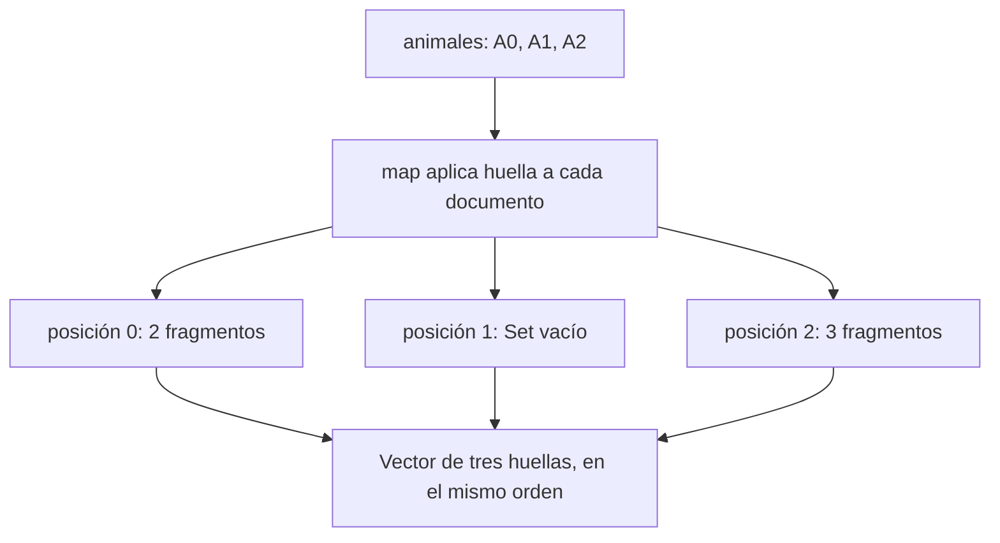

## Conclusión 
`huellas` aplica `huella` a cada documento con `map` y conserva el orden del corpus, incluso cuando una huella queda vacía.

# `huellasPar`

## Definición del algoritmo

```Scala
 def huellasPar(c: Corpus, k: Int): Vector[Huella] = {

    val (corpusIzq, corpusDer) = c.splitAt(c.length / 2)
    val (huellasIzq, huellasDer) = parallel(huellas(corpusIzq, k), huellas(corpusDer, k))
    huellasIzq ++ huellasDer
  }
```  

`huellasPar` calcula lo mismo que `huellas`, pero parte el corpus en dos mitades y calcula las huellas de cada mitad **en paralelo**, es decir, al mismo tiempo.

* `c.length / 2` es la división entera: la mitad del número de documentos, redondeada hacia abajo.
* `c.splitAt(m)` devuelve la pareja formada por los primeros `m` documentos y el resto.
* `parallel(a, b)` evalúa `a` y `b` a la vez y devuelve la pareja de resultados, en el mismo orden en que se escribieron.
* `++` concatena los dos vectores de huellas, el izquierdo primero.

## Explicación paso a paso

1. Se calcula `c.length / 2`.
2. `splitAt` separa `corpusIzq` (los primeros documentos) y `corpusDer` (los demás). Si el número de documentos es impar, la mitad derecha tiene uno más.
3. `parallel` calcula `huellas(corpusIzq, k)` y `huellas(corpusDer, k)` al mismo tiempo.
4. `huellasIzq ++ huellasDer` reúne los resultados en el orden original.

Las dos ramas solo **leen** datos que no cambian, así que pueden trabajar a la vez sin estorbarse. Una rama puede terminar antes que la otra, pero eso no altera el resultado: `parallel` siempre entrega primero el resultado de la izquierda y después el de la derecha.

## Seguimiento de la ejecución
**Ejemplo principal.** Corpus `cadena`, con 5 documentos y `k = 2`. Cada documento comparte palabras con el siguiente.

```Scala
val cadena: Corpus = Vector(
  ("C0", normalizar("a b c")),
  ("C1", normalizar("b c d")),
  ("C2", normalizar("c d e")),
  ("C3", normalizar("d e f")), 
  ("C4", normalizar("e f g")))
```
Aquí `c.length / 2 = 5 / 2 = 2`.


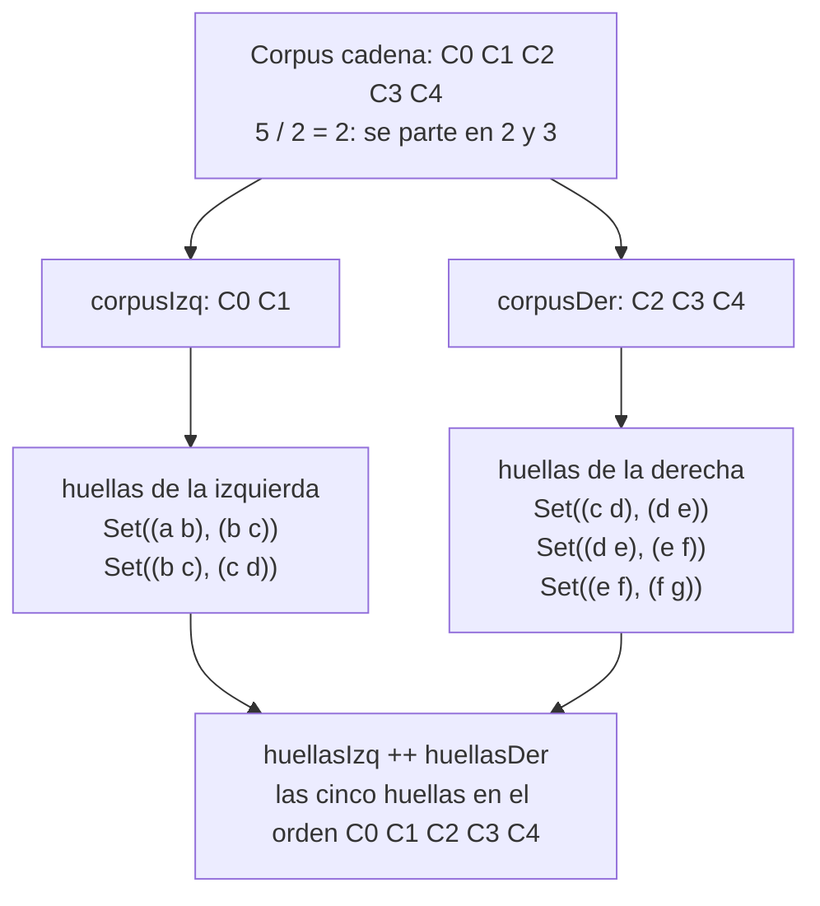

**Ejemplo adicional.** Cómo se parte el corpus según el número de documentos `n`:

| `n` | `n / 2` |Mitad izquierda | Mitad derecha |
|---|---|---|---|
| 0 | 0 | vacía | vacía|
| 1 | 0 | vacía | `D0` |
| 2 | 1 | `D0` | `D1` |
| 3 | 1 | `D0`| `D1, D2` |
| 4 | 2 | `D0, D1` | `D2, D3` |

## Ejemplo de uso 

```Scala
huellasPar(cadena, 2).map(huella => huella.size)
//Vector(2, 2, 2, 2, 2)

huellasPar(Vector(), 2)
//Vector()
```

## Diagrama
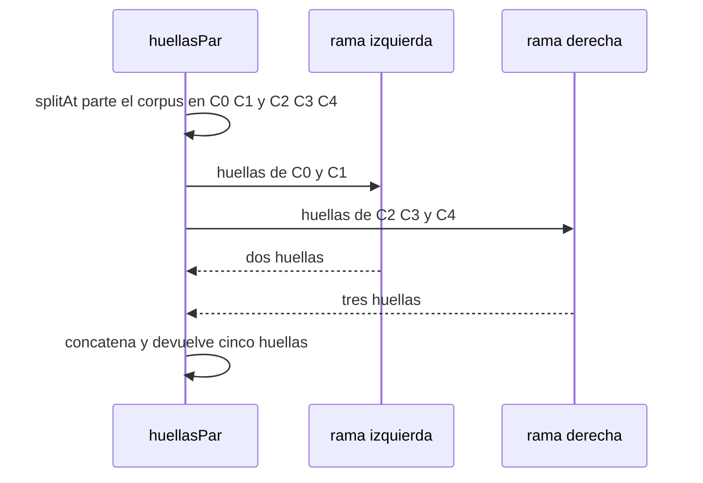

`huellasPar` no se llama a sí misma: divide una sola vez y entrega cada mitad a `huellas`, que es secuencial. Por eso no hay pila de llamados recursivos ni condición de parada; lo que se muestra es la división y la reunión de resultados.

## Conclusión
`huellasPar` divide el corpus con `splitAt`, calcula las dos mitades con `parallel` y las junta con `++`. El resultado es el mismo de `huellas`; solo cambia la forma de ejecutarse.


# `similitudes` 

## Definición del algoritmo

```Scala
def similitudes(hs: Vector[Huella], ps: Vector[Pareja]): Vector[Medicion] = {
    ps.map { case (primerDocumento, segundoDocumento) =>
      (primerDocumento, segundoDocumento,
      jaccard(hs(primerDocumento), hs(segundoDocumento)))
    }
}
       
```

`similitudes` recibe el vector de huellas `hs` y un vector de parejas `ps` y devuelve una medición por pareja: las dos posiciones y la similitud de Jaccard de sus huellas.

* `case (primerDocumento, segundoDocumento) =>` descompone cada pareja en sus dos posiciones.
* `hs(primerDocumento)` y `hs(segundoDocumento)` son las huellas de esos documentos.
* `jaccard` calcula la similitud: tamaño de la intersección entre tamaño de la unión. Si las dos huellas están vacías devuelve `0.0` y no divide por cero.

## Explicación paso a paso
1. `map` toma la primera pareja de `ps`.
2. Busca las dos huellas en `hs` por posición.
3. Calcula `jaccard` y arma la medición `(primerDocumento, segundoDocumento, similitud)`.
4. Repite con las demás parejas; el vector resultante conserva el orden de `ps`.

La función no elige parejas, no las ordena y no aplica ningún umbral: mide exactamente las que recibe. El umbral y el orden los resuelve `ranking`.

## Seguimiento de la ejecución

**Ejemplo principal.** `similitudes(huellas(letras, 2), Vector((0, 1), (0, 2), (1, 2)))`. Las huellas son:


| Posición  | Documento | Huella|
|---|---|---|
| 0| `a b c`| `Set((a b), (b c))` |
| 1| `b c d` | `Set((b c), (c d))`|
| 2 | `x y z` | `Set((x y), (y z))`|

Cómo se procesa la primera pareja, `(0, 1)`:

1. `ps.map` recibe `(0, 1)`.
2. `case (primerDocumento, segundoDocumento)` asigna `primerDocumento = 0` y `segundoDocumento = 1`. No compara números: descompone la pareja.
3. `hs(0)` es `Set((a b), (b c))` y `hs(1)` es `Set((b c), (c d))`.
4. `jaccard` las compara: la intersección es `Set((b c))` (tamaño 1) y la unión es `Set((a b), (b c), (c d))` (tamaño 3). Devuelve `1.0 / 3.0`.
5. Se construye la terna `(0, 1, 0.3333333333333333)`.

Con las tres parejas:

|Pareja  | Intersección | Unión| Similitud |
|---|---|---|---|
| `(0, 1)` | `(b c)`: 1| `(a b)`, `(b c)`, `(c d)`: 3 | 1 / 3 |
| `(0, 2)`| 0| 4| 0 |
| `(1, 2)`| 0| 4| 0 |

**Ejemplo adicional.** `corpus2` con `k = 3` y las parejas `(0, 1)`, `(2, 3)` y `(0, 2)`. Las huellas tienen tamaños 7, 7, 6 y 6.

| Pareja | Intersección | Unión| Similitud |
|---|---|---|---|
| `(0, 1)` | 6| 8| 0.75|
| `(2, 3)`| 4| 8| 0.5|
| `(0, 2)`| 0| 13| 0.0|

La unión se calcula como el tamaño de la primera huella más el de la segunda menos la intersección; por ejemplo, 7 + 7 - 6 = 8.

## Ejemplo de uso 

```Scala
similitudes(huellas(letras, 2), Vector((0, 1), (0, 2), (1, 2)))
// Vector((0,1,0.3333333333333333), (0,2,0.0), (1,2,0.0))

similitudes(huellas(corpus2, 3), Vector((0, 1), (2, 3), (0, 2)))
// Vector((0,1,0.75), (2,3,0.5), (0,2,0.0))

similitudes(huellas(letras, 2), Vector())
// Vector()
                                         
```

## Diagrama

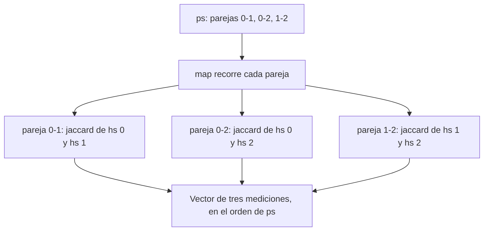

## Conclusión 
`similitudes` convierte cada pareja en una medición con `map`, sin alterar el orden de `ps`. Con `ps` vacío devuelve un vector vacío.

# `indiceInvertido`

## Definición del algoritmo

```Scala
  def indiceInvertido(hs: Vector[Huella]): Indice = {
    //Una entrada (fragmento, documento) por cada fragmento de cada huella
    val entradas =  for {
      documento <- 0 until hs.length
      fragmento <- hs(documento)
    } yield (fragmento, documento)
    // Se agrupa por fragmento y de cada grupo se queda con los documentos
      entradas.groupBy(entrada => entrada._1)
        .map { case (fragmento, grupo) =>
          (fragmento, grupo.map(entrada => entrada._2).toSet)}
  }
```  
`indiceInvertido` recibe el vector de huellas y devuelve un `Map` que asocia cada fragmento con el conjunto de posiciones de los documentos cuya huella lo contiene. Sirve para saber qué documentos comparten fragmentos sin comparar todas las parejas.

La estructura es la de agrupar con `for`: el `for` produce parejas `(fragmento, documento)`, `groupBy` las agrupa por la primera componente y `map` transforma el contenido de cada grupo.

## Traducción del `for`

El `for` con dos generadores y `yield` equivale a `flatMap` sobre el primero y `map` sobre el segundo:

```Scala
 (0 until hs.length).flatMap(documento =>
    hs(documento).map(fragmento => (fragmento, documento))) 
```
Las dos expresiones producen las mismas entradas.

* `documento <- 0 until hs.length` recorre las posiciones válidas de `hs`.
* `fragmento <- hs(documento)` recorre todos los fragmentos de esa huella.
* `yield (fragmento, documento)` produce una entrada por cada relación "el documento contiene el fragmento".
* `entrada._1` es el primer elemento de la pareja (el fragmento) y sirve de clave para `groupBy`.
* `case (fragmento, grupo)` descompone cada entrada del mapa agrupado.
* `entrada._2` es el segundo elemento: la posición del documento.
* `.toSet` convierte esas posiciones en conjunto, que es el tipo que exige `Indice` (`Set[Int]`).

En orden:

1. **Entradas:** el primer generador recorre las posiciones `0, 1, ..., n - 1` y el segundo recorre los fragmentos de la huella de cada posición. Se guarda una entrada por cada fragmento de cada huella.
2. **Agrupación:** `groupBy(entrada => entrada._1)` reúne las entradas con el mismo fragmento.
3. **Conjuntos de documentos:** el `map` final deja, para cada fragmento, los documentos de su grupo como conjunto.

## Seguimiento de la ejecución

Corpus `colores` con `k = 2`. Los tres documentos usan las mismas palabras en distinto orden.

```Scala
val colores: Corpus = Vector(
  ("K0", normalizar("rojo verde azul")),
  ("K1", normalizar("verde azul rojo")),
  ("K2", normalizar("rojo verde azul rojo")))
```

| Posición | Documento | Huella|
|---|---|---|
| 0 | `rojo verde azul` | `Set((rojo verde), (verde azul))` |
| 1 | `verde azul rojo` | `Set((verde azul), (azul rojo))` |
| 2 | `rojo verde azul rojo` | `Set((rojo verde), (verde azul), (azul rojo))`|

| Paso | Valor |
|---|---|
| `entradas` (7 pares) | `((rojo verde),0)`, `((verde azul),0)`, `((verde azul),1)`, `((azul rojo),1)`, `((rojo verde),2)`, `((verde azul),2)`, `((azul rojo),2)` |
| `groupBy` | 3 grupos, uno por cada fragmento distinto |
| resultado | `(rojo verde) -> Set(0, 2)`, `(verde azul) -> Set(0, 1, 2)`, `(azul rojo) -> Set(1, 2)` |

Detalle del fragmento `Vector(verde, azul)`: el `for` produce `(Vector(verde, azul), 0)`, `(Vector(verde, azul), 1)` y `(Vector(verde, azul), 2)`. `groupBy` los reúne bajo una sola clave. El `map` interior extrae `0`, `1` y `2`, y `toSet` obtiene `Set(0, 1, 2)`. Así se construye la asociación `Vector(verde, azul) -> Set(0, 1, 2)`.

Ni `Map` ni `Set` garantizan un orden; el problema solo necesita las asociaciones.

**Ejemplo adicional.** Si `hs` es `Vector()`, el `for` no produce entradas, `groupBy` devuelve un mapa vacío y el resultado es `Map()`.

## Ejemplo de uso 

```Scala
indiceInvertido(huellas(colores, 2))
// Map(Vector(rojo, verde) -> Set(0, 2),
//     Vector(verde, azul) -> Set(0, 1, 2),
//     Vector(azul, rojo) -> Set(1, 2))

indiceInvertido(Vector())
// Map()                                         
```

## Diagrama

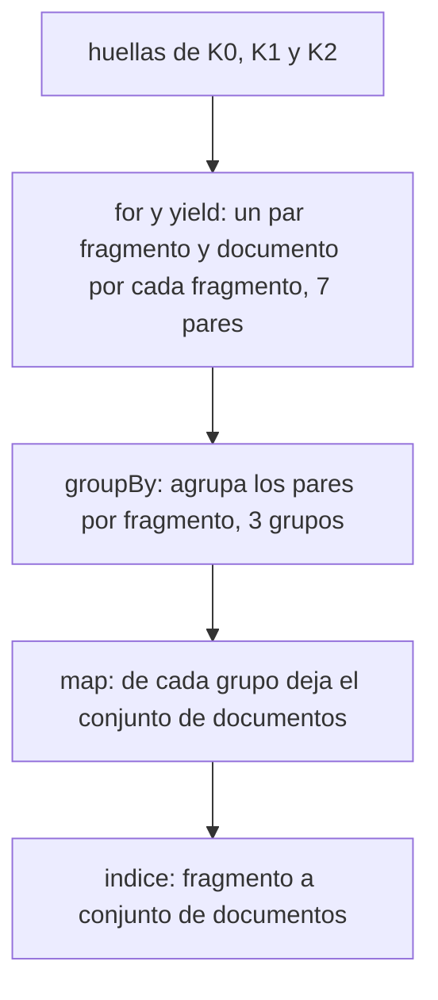
## Conclusión 
`indiceInvertido` genera una entrada por cada fragmento de cada huella, las agrupa por fragmento y deja el conjunto de documentos de cada grupo. Sin huellas devuelve el mapa vacío.

# `detectarDirectoPar`

## Definición del algoritmo

```Scala
def detectarDirectoPar(c: Corpus, k: Int, umbral: Double, p: Int,
                         corte: Int): Vector[Medicion] = {
    val huellasCorpus = huellasPar(c, k)
    val todasLasParejas = parejas(huellasCorpus.length)
    ranking(similitudesPar(huellasCorpus, todasLasParejas, corte), umbral, p)
  }
```
`detectarDirectoPar` recibe el corpus `c`, el tamaño de fragmento `k`, el `umbral` mínimo de similitud, el máximo `p` de resultados y el tamaño `corte` por debajo del cual `similitudesPar` ya no divide el trabajo. Devuelve las parejas más parecidas, de mayor a menor similitud. Es "directo" porque compara **todas** las parejas, sin usar el índice invertido.
 
## Explicación paso a paso

1. `huellasPar(c, k)` calcula las huellas del corpus.
2. `parejas(n)` genera todas las parejas `(i, j)` con `i < j`: para tres documentos hay 3·2/2 = 3 parejas y para cuatro, 4·3/2 = 6.
3.  `similitudesPar` mide la similitud de cada pareja repartiendo el trabajo en paralelo. No se descarta ninguna pareja. Su funcionamiento se resume más abajo.
4. `ranking` conserva las mediciones con similitud mayor o igual a `umbral`, las ordena de mayor a menor y toma como máximo las primeras `p`. Los empates se resuelven por posición `(i, j)`.

Qué aporta cada parámetro: `c` son los documentos, `k` define los fragmentos, `umbral` es la similitud mínima aceptada, `p` limita cuántos resultados se devuelven y `corte` controla el reparto paralelo de las comparaciones.

## Seguimiento de la ejecución

`detectarDirectoPar(corpus2, 3, 0.4, 5, 2)`.

| Paso | Valor |
|---|---|
| `huellasCorpus`| cuatro huellas con tamaños `Vector(7, 7, 6, 6)`|
| `todasLasParejas` | `(0,1)`, `(0,2)`, `(0,3)`, `(1,2)`, `(1,3)`, `(2,3)` |
| `similitudesPar(...)`| `(0,1)` 0.75, `(2,3)` 0.5 y las otras cuatro 0.0|
| `ranking(..., 0.4, 5)` | `Vector((0,1,0.75), (2,3,0.5))` | 

`similitudesPar` aplica dividir y vencer sobre el vector de parejas: si el tramo tiene `corte` parejas o menos lo mide directamente con `similitudes`, y si no lo parte por la mitad y mide las dos mitades en paralelo. Con `corte = 2`, las seis parejas se reparten
como en este árbol. Cada nodo muestra el tramo de parejas que recibe; en las hojas se ven las similitudes que se miden.

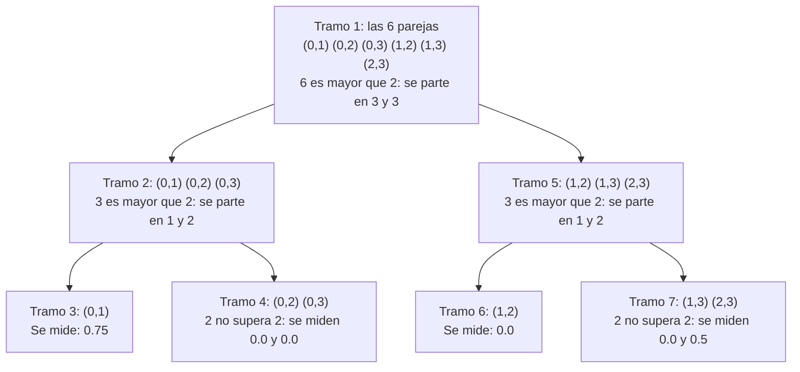
Los resultados suben por el árbol en el mismo orden de las parejas. Cada tramo junta lo que devolvieron sus dos mitades, la izquierda primero:

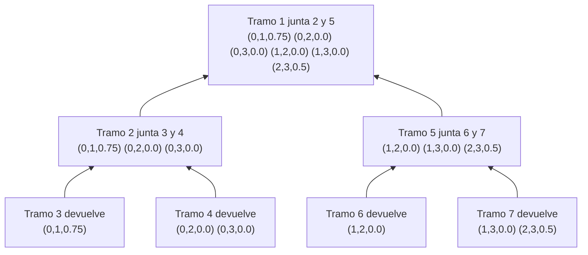
Esta forma de partir por la mitad una y otra vez se parece a la del ordenamiento por mezcla (`sort`), pero aquí no se ordena nada: cada tramo se mide y las mediciones se juntan con `++` sin cambiar el orden de las parejas.

## Ejemplo de uso

```Scala
detectarDirectoPar(corpus2, 3, 0.4, 5, 2)
// Vector((0,1,0.75), (2,3,0.5)) 
         
```
## Diagrama

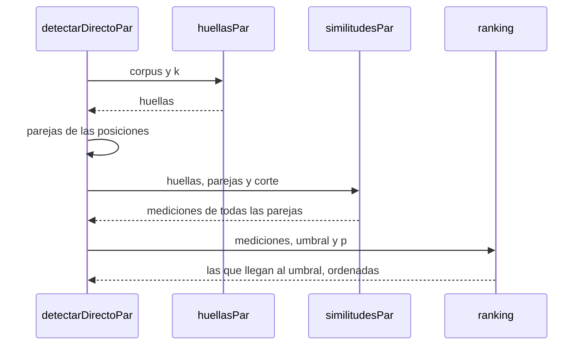

## Conclusión 

`detectarDirectoPar` encadena `huellasPar`, `parejas`, `similitudesPar` y `ranking`. Calcula las huellas, mide todas las parejas, y se queda con las que llegan al umbral, ordenadas y limitadas a `p`. Solo `corte` cambia entre la versión paralela y `detectarDirecto`, y únicamente afecta cómo se reparte el trabajo, no el resultado.
